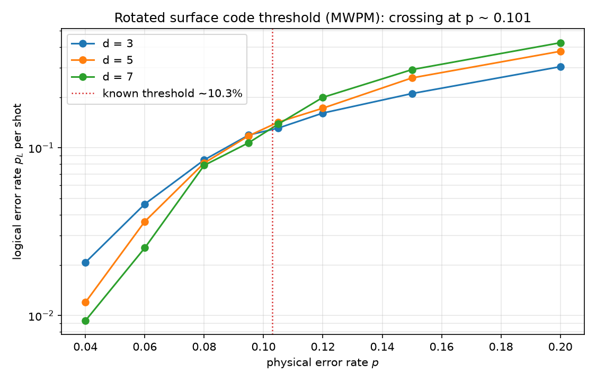
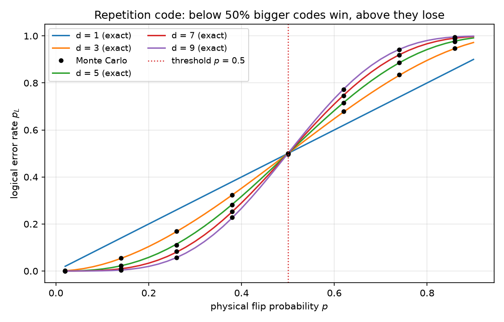

# qec-decoder — quantum error correction measured, not asserted

**Simulating and measuring the surface-code error-correction threshold** from
first principles: the rotated surface code built qubit by qubit, Pauli noise
injection, minimum-weight perfect matching (MWPM) decoding with networkx
Blossom, and Monte Carlo measurement of the famous threshold:

```
measured threshold:  p* = 0.1012      known MWPM value: ~0.103
```

Below p*, enlarging the code *suppresses* logical errors exponentially;
above it, enlarging amplifies them. That crossing is the entire point of
fault-tolerant quantum computing, and this repo reproduces it.

## Results

| Quantity | Reference | This code |
|---|---|---|
| MWPM code-capacity threshold (X-sector, perfect syndrome) | ~10.3% | **10.12%** ✓ |
| Sub-threshold scaling at p = 0.04 | d=7 < d=5 < d=3 | 0.0093 < 0.0120 < 0.0208 ✓ |
| Above-threshold scaling at p = 0.20 | d=7 > d=5 > d=3 | 0.423 > 0.376 > 0.305 ✓ |
| Repetition code MC vs exact majority formula | analytic | agree within 4σ ✓ |
| Repetition threshold | 50% | 50% (analytic + MC) ✓ |
| Decoder validity | syndrome(E⊕C) = 0 | verified on 200 random patterns ✓ |
| Logical undetectable errors | full column flips logical | verified ✓ |

| | |
|---|---|
|  | The crossing: d = 3, 5, 7 curves intersect at p ≈ 0.10 — the threshold. |
|  | The warm-up: 1D repetition code, exact majority formula vs Monte Carlo, crossing at 50%. |

## How it works

1. **Rotated surface code** (`lattice.py`): d² data qubits, staggered
   weight-2/4 stabilizers (checkerboard + rough/smooth boundaries), logical
   X = column, logical Z = row. One logical qubit encoded per d² physical.
2. **Noise**: independent X errors at rate p per data qubit (the Z sector is
   symmetric and decoupled). Flipped stabilizers = syndrome defects.
3. **Decoding** (`matching.py`): MWPM on the defect graph; boundaries via
   side-aware virtual nodes; corrections built with **syndrome verification**
   (a chain is only accepted if its syndrome is exactly its defect pair).
4. **Measurement** (`threshold.py`): logical failure = parity of (error ⊕
   correction) along a logical operator row; Monte Carlo over thousands of
   shots per (d, p) cell.

## The decoder lessons (each cost an iteration -- documented in code)

- **Side-aware boundaries**: matching weights must distinguish top vs bottom
  exits. Side-blind weights silently produced ~3% failure floors.
- **Virtual nodes must mix at zero cost**: forbidding T-B virtual edges
  removed the *mixed-side* pairing, which is the optimal decode whenever the
  error strands exit opposite boundaries.
- **The metric is the chain length, not Manhattan distance**: diagonal
  Z-stabilizer pairs connect with 1-2 qubit "kite" chains that Manhattan
  overcounts 2-4x; weights are now the exact verified chain lengths.
- **Dijkstra, not BFS, between defects**: two-hop routes can differ 2x in
  chain qubits; route cost must sum real hop lengths.
- **Geometry lies**: every chain is verified against the syndrome map before
  use -- staircase paths on the staggered lattice can flip the wrong
  stabilizers.

## Repository layout

```
qec-decoder/
├── src/qec/
│   ├── lattice.py      # rotated surface code: stabilizers, syndromes, logicals
│   ├── matching.py     # MWPM decoder (networkx) + verified chain builders
│   ├── repetition.py   # 1D repetition code + exact analytic failure formula
│   └── threshold.py    # Monte Carlo sweeps and crossing-point estimation
├── scripts/run_repetition.py    # analytic vs MC, threshold at 50%
├── scripts/run_threshold.py     # the surface-code threshold measurement
├── tests/             # 17 physics tests (pytest)
└── figures/, results/ # generated plots and CSV data (committed)
```

## Quickstart

```bash
python -m venv .venv
# Windows: .venv\Scripts\activate   |   Linux/macOS: source .venv/bin/activate
pip install -r requirements.txt
pip install -e .

pytest                          # 17 physics tests, ~15 s
python scripts/run_repetition.py
python scripts/run_threshold.py # full threshold sweep (~1-2 min)
```

## Scope & roadmap

- Current model: perfect stabilizer measurement, code capacity (independent
  X/Z data noise), MWPM weights from verified chain lengths.
- [ ] Noisy syndrome rounds (phenomenological noise) -> 3D matching graph
  (threshold ~2-3%)
- [ ] Depolarizing noise with correlated matching
- [ ] ML decoder (small neural network) benchmarked against MWPM
- [ ] Larger distances (d = 9, 11) and error bars on the crossing point

## References

- Fowler et al., *Surface codes: Towards practical large-scale quantum
  computation*, Phys. Rev. A 86, 032324 (2012) -- the threshold literature
- Dennis et al., *Topological quantum memory*, J. Math. Phys. 43, 4452 (2002)
- Horsman et al., *Surface code quantum computing by lattice surgery* (2012)
- networkx Blossom implementation (Kolmogorov's algorithm) for MWPM

## License

MIT — see [LICENSE](LICENSE).
